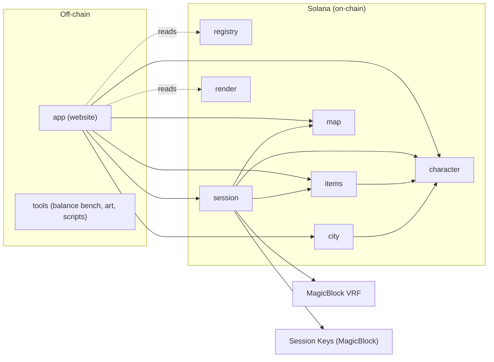

# Deadroll

Deadroll is a tabletop RPG where the dice, the dungeon and the dead all live on Solana. A player runs the dungeon as the Dungeon Master, the others bring heroes built from modular skill parts, and a hero that dies is gone for good. Characters, maps, combat, dice, deaths and even the renderer that draws the pixel art are stored and run on-chain.

- Website: https://deadroll-theta.vercel.app/ (plays on Solana devnet)

## The game today

- **Heroes with stats.** Strength, Dexterity, Intelligence and Endurance shape what a hero is good at. Strength powers martial strikes and their states, Dexterity gives accuracy, evasion and speed, Intelligence powers magic and initiative, Endurance gives HP and resistance to states. Level-ups give points that the player spends in one transaction. Race and class add traits that grow by tier.
- **Chances on a d100.** Hit, crit, status effects and resonances are rolled as percentages. The site previews your chance to hit and to crit and the damage range before you commit to an attack.
- **Aspects, resonances and tints.** Skills carry up to three aspects (Fire, Frost, Lightning and others). Mixing aspects can trigger resonances, and the race, class or weapon aspect gives a tint trait on top: Fury, Composure, Swiftness, Wasting, Crushing, Keenness. States spread between units, burning cells stay on the map, Frost can thaw into damage.
- **Resistances.** Armor and aspect resistance cut damage, state resistance cuts the chance of Stun, Freeze and the rest, and some monsters are immune to whole aspects or tags.
- **A modular skill builder.** Players build skills block by block: purpose, source, form, target, aspects, effect, trigger and aura. Before a fight they pick 4 active, 1 reactive and 1 passive skill.
  - Active skills cost action points and have cooldowns and a melee or ranged reach.
  - Reactive skills fire on a trigger: being hit, a crit, low HP, a hurt ally, being controlled, an enemy stepping adjacent.
  - Passive skills are always on. Auras reach everyone within a radius.
  - Line skills pass through the target and hit every unit behind it, one roll each.
  - Buffs and debuffs never subtract, they divide, as counterweights. Players have no heal skills for now.
- **Monsters from the registry.** The bestiary lives on-chain with stats, natural attacks, skills, packs of kin and elite versions. The DM places them on a map and moves them, or lets them play on their own.
- **Gear in the character.** A class starter kit and equipped items sit inside the character account. Equipping happens outside a party, and Ready locks the character and its gear for the session.
- **Turns.** One action per turn, automatic turn start, Freeze and Stun skip a turn, Burning and Bleeding tick.
- **Dice you can check.** Each action asks MagicBlock VRF for one random value, and every roll of that action is derived from it. The site replays the rolls as a dice cascade with the full hit breakdown, and every event links to its transaction.
- **Permadeath.** Deaths are finalized by the programs. A dead hero loses its skill mechanics, its bag and its starter items, and keeps only the skill names on the tombstone.
- **On-chain art.** The rasterizer, the palette (palette 2) and the sprite books are stored on-chain, and the site checks the rasterizer's SHA-256 against `GameConfig` before it draws. Sprites are pixel by pixel, each pixel a role slot that the renderer colors, shades and outlines. A character is its body plus the items it wears, so equipping changes the picture.
- **Party economy.** The DM builds a map, opens a party and sets its price. Players pay into an on-chain escrow, survivors get XP, and the DM claims the escrow.
- **Session keys.** A MagicBlock session key keeps wallet popups out of play.

### Status

Devnet runs the same code as `main` (last upgrade 20.10).

| Area | State |
|---|---|
| Stats, d100 chances, states, resonances and tints | working |
| Active, reactive and passive skills, auras, line skills | working |
| Resistances (aspect, state, tag, Resistance effect) | working |
| Registry monsters with skills, kin and elites | working |
| Gear in the character, equip and unequip | working |
| On-chain art, palette 2, characters drawn from body and gear | working |
| Party, escrow, VRF combat, death, victory, payout | working |
| TypeScript SDK (Codama), hosted website | working |
| Balance bench (`tools/balance`) | working |
| Session key set up in a single transaction | next |
| Loot from monsters | next |
| Crafting and item NFTs (`items`) | next |
| City and buildings (`city`) | next |

The task board is [agents/TASKS.md](agents/TASKS.md).

## Devnet

These program ids are the same on every cluster (see `app/src/config.ts`):

| Program | Address |
|---|---|
| `registry` | `dZ1jraMfS3bAUTkRw2TA1ddg8UDGzgUdFQz5pmBxjoG` |
| `render` | `DgQCsXAe7Q7h8zdtToiTvk8XqNjjbXuD6xith2BmEiRB` |
| `character` | `9uVNvkt5kTMad65GtdqQmBb3X1JQMWwQ985qLwTCdqfL` |
| `items` | `48FtbrDegNrAUHFza9HdJzZAvUo3uUNqs1kNnZxFsqJS` |
| `map` | `2YeyBfQ5xkRKD2kagxRS2yZYCQdWt5qidikaKfQhLBXH` |
| `session` | `3gzfih2WaBgXcYZ57jWokmZM3FDE6QHX5y4R9EvKZoNJ` |
| `city` | `2Cr5vB5awqDVx6XRcxtFFYQEG6Zy3aSAcKcqzh1xbVjS` |

`GameConfig` on devnet: `HYGYnuyssMfrHr2gT3AC3hkQpD6xt37a5hrCc2Z97JHN`.

## Architecture



There are seven Anchor programs, split by domain so that each part can change on its own:

| Program | Owns |
|---|---|
| `registry` | `GameConfig`, aspects, resonance and bestiary tables, tileset, prefabs |
| `character` | profile, character, skills, bag, gear, Core NFT mint |
| `items` | item state, affixes, crafting (not built yet) |
| `map` | maps, validation, finalization, layout |
| `session` | party, turns, combat, states, skills, auras, VRF callback, party price escrow |
| `city` | city and buildings (not built yet) |
| `render` | the rasterizer WASM, palette and sprite books, stored on-chain |

Shared logic lives in pure Rust crates with no Anchor dependency. The programs, the website (through WASM or a fixture-tested mirror) and the balance bench all run the same rules:

| Crate | Purpose |
|---|---|
| `types` | shared types, interfaces between programs (only ever extended) |
| `combat` | integer-only hit, state, buff, debuff and resonance resolution; all dice go through `RollSource` |
| `rules` | balance numbers (`BalanceConfig`), derived stats, registry tables, item rules, shared by programs and the bench |
| `sim` | battle simulator and AI, the engine of the balance bench |
| `skillcheck` | skill and loadout validation, derived power, cooldown and range |
| `mapcheck` | map validation (bounds, spawns, path from entrance to exit) |
| `render` | sprite DSL decoder, shading, outline, PNG encoder; builds to WASM |

Principles:

- a monorepo with one folder per zone;
- no backend: the site talks to the chain through the player's wallet and session key;
- the rasterizer is always loaded from the chain and checked against the hash in `GameConfig`.

Details are in [docs/ARCHITECTURE.md](docs/ARCHITECTURE.md).

## Tech stack

- **Programs:** Anchor 1.2.1, Solana CLI 4.1.2 (Agave), Rust 1.92.0, platform tools v1.54
- **On-chain services:** MagicBlock VRF (`ephemeral-vrf-sdk`) and Session Keys (`session-keys`), Metaplex Core (`mpl-core`)
- **Client:** Vite 8, React 19, TypeScript, `@solana/kit` 8 with the Wallet Standard plugin
- **Tooling:** Node 22 or newer, pnpm 10, a local `solana-test-validator`, Codama for the SDK, egui for the balance bench

## Quick start

### 1. Quick look, no validator

The app has a mock mode that needs no chain. It still runs the real rasterizer loader, including the SHA-256 check, on synthetic accounts.

```
pnpm install
cargo test -p deadroll-render --test golden      # writes target/render-golden/*.bin
bash crates/render/wasm/build.sh                 # builds target/render-wasm/deadroll_render.wasm
pnpm --filter @deadroll/app dev                  # VITE_DATA=mock by default
```

Open `/dev/grid`, `/dev/dice` and `/dev/forms` to see the UI components on mock data.

### 2. Full game on a local validator

Native Windows `solana-test-validator` cannot create its ledger, so run the validator in WSL at `http://127.0.0.1:8899`. Clone Session Keys and Metaplex Core into it from devnet. Local VRF uses the `session` program's `mock-vrf` feature, which the deploy script turns on for localnet only.

One command deploys the whole stack:

```
pnpm --filter @deadroll/scripts run deploy:local
```

It does the following, and skips any step that is already done:

- builds the programs, with `mock-vrf` on for `session`;
- deploys the 7 programs and creates `GameConfig`;
- seeds the registry;
- uploads the rasterizer, palette and sprites;
- creates a demo map.

Then start the app in localnet mode. It reads chain data from `127.0.0.1:8899` and plays the mock VRF oracle:

```
pnpm --filter @deadroll/app dev:localnet
```

Open `http://localhost:5173/?dev=1` in three tabs or windows: DM, warrior, mage. With a local RPC, `?dev=1` gives each tab its own keypair and airdrops 5 SOL to it, so no wallet extension is needed. The app never offers it with a non-local RPC.

1. **Character:** each player creates a character and builds skills or takes the class presets. This mints a Core NFT.
2. **Map builder:** the DM validates and finalizes a map, then opens a party on it with a price.
3. **Party:** players join (they pay into escrow and bind a session key) and press Ready. The DM starts the session.
4. **Battle:** click a cell to move, a monster to attack, or an ally to buff, then press End turn. The DM moves the monsters or lets them play on their own.
5. **End:** claim the rewards. The DM then claims the escrow.

[tools/scripts/README.md](tools/scripts/README.md) describes the script arguments and environment. [app/README.md](app/README.md) has the full play flow.

### 3. Devnet

```
pnpm --filter @deadroll/app dev:devnet
```

Devnet mode reads its non-secret values from `app/.env.devnet`. Set the RPC in one of two ways:

- **Custom RPC** in the app header: an RPC URL and an optional WebSocket URL. They stay in your browser's localStorage and are never bundled.
- `VITE_RPC_URL` in an untracked `app/.env.devnet.local`.

If neither is set, a hosted build uses the public devnet RPC. `vite build` refuses any `VITE_RPC_URL` other than the public devnet RPC or localhost, so no provider key ends up in the bundle.

### Tests

```
cargo test -p deadroll-combat                    # one crate; same for the others
cargo run -p balance --release                   # balance bench (egui)
pnpm --filter @deadroll/app test
DEADROLL_LOCALNET=1 pnpm --filter @deadroll/app exec vitest run src/chain/localnet.e2e.test.ts
cd tests && ANCHOR_PROVIDER_URL=http://127.0.0.1:8899 ANCHOR_WALLET=<funded keypair json> \
  node --import tsx --test --test-concurrency=1 session.test.ts
```

Programs for deploy are always built by the deploy scripts, never taken from `anchor build`. For checks, pass `--tools-version v1.54` to `anchor build`. The default platform tools make `cargo-build-sbf` panic on Windows, and using one version everywhere keeps the builds identical.

## Repository layout

```
programs/   registry, character, items, map, session, city, render   (Anchor)
crates/     types, combat, skillcheck, mapcheck, render, rules, sim   (pure Rust, no Anchor)
sdk/        TypeScript client generated by Codama from sdk/idl (committed, `pnpm --filter @deadroll/sdk check` fails if stale)
app/        Vite + React + TypeScript website
tests/      cross-program integration tests, devnet VRF smoke test
tools/      balance/ (egui balance bench, JSON presets), art/ (sprite preview and validator), scripts/ (deploy, uploads, registry seeding)
assets/     sprites/ (geometry DSL sources), registry/ (aspects, tables, bestiary, presets as JSON)
agents/     task board, interfaces between programs, agent guides
docs/       design documents
```

Every program, crate and app folder has its own `README.md` and a short `CLAUDE.md` with zone rules.

## Documentation

The design documents in [docs/](docs/) are the source of truth for game rules.

| Topic | Doc |
|---|---|
| Code split, CPI, trust, crates | [ARCHITECTURE.md](docs/ARCHITECTURE.md) |
| Character, stats, races, classes | [CHARACTER.md](docs/CHARACTER.md) |
| Aspects, states, resonances, reactions | [DAMAGE_TYPES_AND_MIXES.md](docs/DAMAGE_TYPES_AND_MIXES.md) |
| Hit calculation, dice, modifiers | [COMBAT_MATH.md](docs/COMBAT_MATH.md) |
| Skills, lenses, loadout | [SKILL_BUILDER.md](docs/SKILL_BUILDER.md) |
| Party, turns, action points, rewards | [PARTY_AND_TURNS.md](docs/PARTY_AND_TURNS.md) |
| Monsters, packs, bosses | [BESTIARY.md](docs/BESTIARY.md) |
| Items, affixes, craft | [ITEMS_AND_CRAFT.md](docs/ITEMS_AND_CRAFT.md) |
| Map, tiles, spawns | [MAP_DESCRIPTION.md](docs/MAP_DESCRIPTION.md) |
| City and buildings | [CITY_DESCRIPTION.md](docs/CITY_DESCRIPTION.md) |
| Sprite DSL, slots, shading | [ART_DESCRIPTION.md](docs/ART_DESCRIPTION.md) |
| Rasterizer storage, upload, NFT uri | [STORAGE_AND_DELIVERY.md](docs/STORAGE_AND_DELIVERY.md) |
| Fees, session keys, VRF, party price | [GAME_COMMISSIONS.md](docs/GAME_COMMISSIONS.md) |

Contributor and agent rules are in [CLAUDE.md](CLAUDE.md). The frozen interfaces are in [agents/CONTRACTS.md](agents/CONTRACTS.md).
