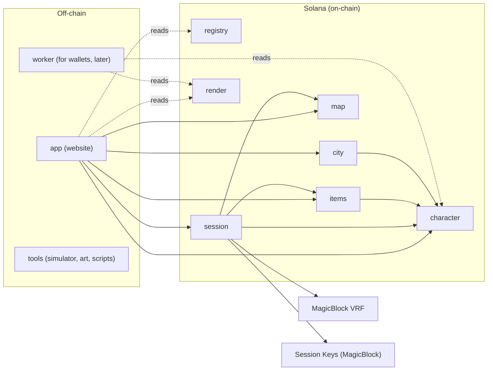

# Deadroll

Deadroll is a fully on-chain tabletop RPG on Solana. Real Dungeon Masters run live sessions, and everything that matters happens on-chain: characters, maps, turn-based combat, dice, deaths, and even the sprite renderer that draws the pixel art. Every dice roll is public. Every death leaves a mark: a fallen character becomes a tombstone and its NFT is frozen.

## What works in the demo

The demo is a single scripted run, end to end on devnet:

1. The website loads the **rasterizer WASM from the chain**, checks its SHA-256 and draws sprites from the on-chain sprite book.
2. Two players create characters (a human warrior with piercing predisposition, a forest elf mage with cold). Each character is a **Metaplex Core NFT** backed by a PDA with its state.
3. Players start a **session key** once, so there are no wallet popups during play.
4. The DM builds a map from a preset in the builder, validates and finalizes it, opens a party with a price, and players pay into escrow and join.
5. Combat against wolves: initiative, moves, attacks, **VRF rolls**, a dice cascade with a full hit breakdown, and a resonance trigger.
6. A character dies and becomes a **tombstone** (the sprite changes, the NFT is frozen).
7. The party kills the goblin chief: victory, XP, loot, and the DM receives the party price from escrow.
8. Anyone can open the explorer: every roll and every transaction is public.

### Status

| Area | State |
|---|---|
| Shared crates (`types`, `combat`, `render`, `mapcheck`, `skillcheck`) | merged |
| `registry`, `render`, `character`, `map` programs | merged |
| `session`: lobby, escrow, actor auth, turns, VRF combat, death, victory, flee, payout | merged |
| App: shell, rasterizer loader, session key, grid, dice cascade, forms | merged, wiring to chain in progress |
| TypeScript SDK (Codama), devnet deploy and seeding | in progress |
| `items`, `city`, worker for wallets, balance simulator | post-demo skeletons |

The live task board is [agents/TASKS.md](agents/TASKS.md).

## Architecture



Seven Anchor programs, split by domain so that parts change independently:

| Program | Owns |
|---|---|
| `registry` | `GameConfig`, aspects, resonance and bestiary tables, tileset, prefabs |
| `character` | profile, character, skills, bag, Core NFT mint and freeze |
| `items` | item state, affixes, crafting (post-demo) |
| `map` | maps, validation, finalization, layout |
| `session` | party, turns, combat, VRF callback, party price escrow |
| `city` | city and buildings (post-demo) |
| `render` | the rasterizer WASM, palette and sprite books, stored on-chain |

Shared logic lives in pure Rust crates with no Anchor dependency, so the programs, the website (through WASM) and the simulator all run the same code:

| Crate | Purpose |
|---|---|
| `types` | shared types, frozen interfaces |
| `combat` | integer-only hit resolution; all dice go through `RollSource` |
| `skillcheck` | skill and loadout validation |
| `mapcheck` | map validation (bounds, spawns, path from entrance to exit) |
| `render` | sprite DSL decoder, shading, outline, PNG encoder; builds to WASM |

Principles: a monorepo with one folder per zone, no backend (the site talks to the chain through the player's wallet), and the rasterizer is always loaded from the chain and verified against the hash in `GameConfig`. Details are in [docs/ARCHITECTURE.md](docs/ARCHITECTURE.md).

## Tech stack

- **Programs:** Anchor 1.2.1, Solana CLI 4.1.2 (Agave), Rust 1.92.0, platform tools v1.54
- **On-chain services:** MagicBlock VRF (`ephemeral-vrf-sdk`) and Session Keys (`session-keys`), Metaplex Core (`mpl-core`)
- **Client:** Vite 8, React 19, TypeScript, `@solana/kit` 8 with the Wallet Standard plugin, Codama-generated SDK
- **Tooling:** Node 22 or newer, pnpm 10, Surfpool or a local validator

## Run locally

### Quick look, no validator

The app has a mock mode that needs no chain. It still runs the real rasterizer loader, including the SHA-256 check, over synthetic accounts.

```
pnpm install
cargo test -p deadroll-render --test golden      # writes target/render-golden/*.bin
bash crates/render/wasm/build.sh                 # builds target/render-wasm/deadroll_render.wasm
pnpm --filter @deadroll/app dev                  # VITE_DATA=mock by default
```

Open `/dev/grid`, `/dev/dice` and `/dev/forms` for the UI components on mock data.

### Full local chain

Native Windows `solana-test-validator` cannot create its ledger, so run the validator in WSL at `http://127.0.0.1:8899`, with Session Keys and Metaplex Core cloned from devnet. Local VRF uses the `session` program's `mock-vrf` feature. Never enable `mock-vrf` for devnet.

```
anchor build --tools-version v1.54
anchor deploy -p registry --provider.cluster localnet     # repeat for each program you need
pnpm --filter @deadroll/scripts seed-registry
pnpm --filter @deadroll/scripts upload-rasterizer
pnpm --filter @deadroll/scripts upload-sprites
```

Then point the app at the chain in `app/.env.local`:

```
VITE_DATA=chain
VITE_RPC_URL=http://127.0.0.1:8899
VITE_CHAIN=solana:localnet
VITE_SPRITE_BOOKS=1
```

and run `pnpm --filter @deadroll/app dev`. The script arguments and environment are described in `tools/scripts/`.

### Tests

```
cargo test -p deadroll-combat                    # one crate; same for the others
pnpm --filter @deadroll/app test
cd tests && ANCHOR_PROVIDER_URL=http://127.0.0.1:8899 ANCHOR_WALLET=<funded keypair json> \
  node --import tsx --test --test-concurrency=1 session.test.ts
```

Always pass `--tools-version v1.54` to `anchor build`: the default platform tools make `cargo-build-sbf` panic on Windows, and one version everywhere keeps builds identical.

## Repository layout

```
programs/   registry, character, items, map, session, city, render   (Anchor)
crates/     types, combat, skillcheck, mapcheck, render               (pure Rust, no Anchor)
sdk/        TypeScript client generated by Codama from the IDLs
app/        Vite + React + TypeScript website
tests/      cross-program integration tests
tools/      art/ (sprite preview and validator), scripts/ (uploads, registry seeding)
assets/     sprites/ (geometry DSL sources), registry/ (aspects, tables, bestiary, presets as JSON)
agents/     task board, frozen interfaces, agent guides
docs/       design documents
```

Every program, crate and app folder has its own `README.md` and a short `CLAUDE.md` with zone rules.

## Documentation

The design documents in [docs/](docs/) are the source of truth for game rules.

| Topic | Doc |
|---|---|
| Code split, CPI, trust, crates | [ARCHITECTURE.md](docs/ARCHITECTURE.md) |
| Character, stats, races, classes | [CHARACTER.md](docs/CHARACTER.md) |
| Aspects, states, resonances, reactions | [DAMAGE_TYPES_AND_MIXES.md](docs/DAMAGE_TYPES_AND_MIXES.md) |
| Hit calculation, dice, modifiers | [COMBAT_MATH.md](docs/COMBAT_MATH.md) |
| Skills, lenses, loadout | [SKILL_BUILDER.md](docs/SKILL_BUILDER.md) |
| Party, turns, action points, rewards | [PARTY_AND_TURNS.md](docs/PARTY_AND_TURNS.md) |
| Monsters, packs, bosses | [BESTIARY.md](docs/BESTIARY.md) |
| Items, affixes, craft | [ITEMS_AND_CRAFT.md](docs/ITEMS_AND_CRAFT.md) |
| Map, tiles, spawns | [MAP_DESCRIPTION.md](docs/MAP_DESCRIPTION.md) |
| City and buildings | [CITY_DESCRIPTION.md](docs/CITY_DESCRIPTION.md) |
| Sprite DSL, slots, shading | [ART_DESCRIPTION.md](docs/ART_DESCRIPTION.md) |
| Rasterizer storage, upload, NFT uri | [STORAGE_AND_DELIVERY.md](docs/STORAGE_AND_DELIVERY.md) |
| Fees, session keys, VRF, party price | [GAME_COMMISSIONS.md](docs/GAME_COMMISSIONS.md) |

Contributor and agent rules are in [CLAUDE.md](CLAUDE.md), and the frozen interfaces are in [agents/CONTRACTS.md](agents/CONTRACTS.md).
