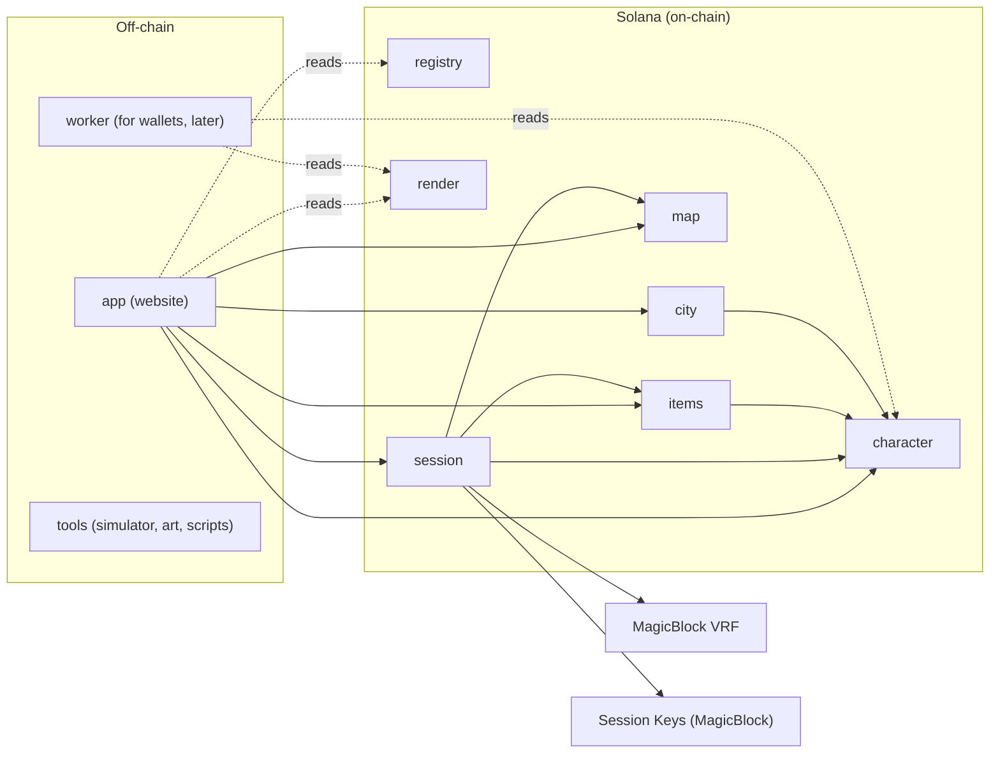

# ARCHITECTURE: Deadroll project architecture

Version 0.1. The main document for developers and AI agents: how the repository is organized, which programs, crates and apps it contains, who calls whom, and how it is tested and updated.

The game design is described in the other documents in `docs/`. This document is about the **code structure**.

---

## 1. Overview



Principles:

1. **Monorepo.** One git repository, with folders by zone inside. Each folder has its own README, its own tests, its own dependencies and its own `CLAUDE.md` for agents.
2. **Split by domain**, so that parts change independently. What is called on every turn (combat) lives in one program.
3. **Shared logic in crates without Anchor**, so that it is used by the programs, the website (via WASM) and the simulator.
4. **No backend.** The website talks to the chain directly through the player's wallet.

---

## 2. Repository structure

```
deadroll/
├── README.md                 project showcase
├── CLAUDE.md                 rules for AI agents for the whole repository
├── LICENSE
├── Anchor.toml               Anchor configuration (all programs)
├── Cargo.toml                Rust workspace (programs + crates + tools)
├── rust-toolchain.toml       pinned Rust version
├── package.json              JS workspace (app, sdk, tests, worker)
├── pnpm-workspace.yaml
├── .nvmrc                    pinned Node version
├── .gitignore                keys, .env, target/, node_modules/
│
├── .github/
│   ├── workflows/            CI by zone (section 9)
│   ├── ISSUE_TEMPLATE/
│   ├── PULL_REQUEST_TEMPLATE.md
│   └── CODEOWNERS
│
├── docs/                     design documents (public)
│   ├── README.md             table of contents
│   ├── ARCHITECTURE.md       this document
│   ├── CHARACTER.md
│   ├── SKILL_BUILDER.md
│   ├── DAMAGE_TYPES_AND_MIXES.md
│   ├── COMBAT_MATH.md
│   ├── PARTY_AND_TURNS.md
│   ├── BESTIARY.md
│   ├── ITEMS_AND_CRAFT.md
│   ├── MAP_DESCRIPTION.md
│   ├── CITY_DESCRIPTION.md
│   ├── ART_DESCRIPTION.md
│   ├── STORAGE_AND_DELIVERY.md
│   └── GAME_COMMISSIONS.md
│
├── programs/                 Anchor programs (section 3)
│   ├── registry/
│   ├── character/
│   ├── items/
│   ├── map/
│   ├── session/
│   ├── city/
│   └── render/
│
├── crates/                   shared Rust crates without Anchor (section 5)
│   ├── types/
│   ├── combat/
│   ├── skillcheck/
│   ├── mapcheck/
│   ├── render/
│   ├── rules/
│   └── sim/
│
├── sdk/                      TypeScript client generated from the program IDLs
├── app/                      game website (section 6)
├── worker/                   worker for wallets (later, STORAGE_AND_DELIVERY.md)
├── tests/                    integration tests across programs (section 8)
├── tools/
│   ├── balance/              balance bench (egui) and JSON presets, runs `crates/sim`
│   ├── art/                  validator and sprite preview for the AI artist
│   └── scripts/              deploy, rasterizer upload, registry population
└── assets/
    ├── sprites/              sprite sources in the geometry DSL
    └── registry/             registry data: aspects, tables, bestiary (JSON/TOML)
```

**Not stored in the repository:** the internal brief with the secret lore, keys (`*.json` with a keypair), `.env`, DM map secret files.

### 2.1 What is in each zone folder

Each program, crate or app folder is self-sufficient:

| File                          | Purpose                                                                                 |
| ----------------------------- | --------------------------------------------------------------------------------------- |
| `README.md`                   | what it is, how to build and test it on its own                                         |
| `CLAUDE.md`                   | rules for the agent in this zone specifically: commands, constraints, links to the relevant documents |
| `Cargo.toml` / `package.json` | its own dependencies                                                                    |
| `src/`                        | code                                                                                    |
| `tests/`                      | tests of this zone                                                                      |

---

## 3. Programs

### 3.1 List

| Program       | Owns accounts                                                                                                                       | Changes when                          |
| ------------- | ----------------------------------------------------------------------------------------------------------------------------------- | ------------------------------------- |
| **registry**  | `GameConfig`, aspect registry, tables of resonances, fusions, reactions, collisions, bestiary, tileset, `PrefabBook`, reward tables | new aspects, monsters, balance        |
| **character** | player profile, character, skills, bag, storage, achievements                                                                       | new races, classes, professions       |
| **items**     | item state, NFT item collection, artisan listings, crafting                                                                         | new recipes, affixes, professions     |
| **map**       | maps, their validation and finalization, secrets root, `layout` PDA                                                                 | new tiles, builder rules              |
| **session**   | party, `Participation`, turns, combat, VRF callback, temporary cache, party price escrow                                            | new combat mechanics                  |
| **city**      | city, buildings, interiors, order board, secret slots                                                                               | new buildings                         |
| **render**    | `SpriteBook`, `Palette`, `RasterizerCode`                                                                                           | new art, new rasterizer version       |

### 3.2 Program structure

```
programs/session/
├── Cargo.toml
├── README.md
├── CLAUDE.md
├── lib/
│   └── Cargo.toml            the same program as an rlib, for other crates
├── src/
│   ├── lib.rs                list of instructions
│   ├── state/                accounts: game_session.rs, participation.rs...
│   ├── instructions/         one instruction = one file
│   ├── cpi_out/              wrappers for calls into other game programs
│   └── errors.rs
└── tests/
```

The folder is `cpi_out`, not `cpi`: `#[program]` generates a crate-level `cpi` module, and the Anchor IDL build does not follow `#[path]`.

A program that other crates use (for CPI or for its account types) has a second package in lib/. It compiles the same src/ (path = "../src/lib.rs") as an rlib, with the same features and dependencies, and [workspace.dependencies] points to it. Other crates never depend on the program package itself. The reason: a program is a cdylib, and cargo leaves the hash out of a cdylib's file names. So the build of the program and its cpi build for another program would write the same files in target/ and take each other's output: random E0463 and E0308 errors, or an empty cpi binary in target/deploy/. registry, map, character and session have a lib/. A program that becomes a dependency gets one first.

### 3.3 All of combat in one program

Turns, hits, resonances, fusions, collisions, reactions and the VRF callback live in `session`. That is hundreds of calls per party; if every hit went through CPI into a separate program, it would be more expensive and more complex. CPI into other programs happens only **at party boundaries**.

---

## 4. Program interaction

### 4.1 Who calls whom (CPI)

| Caller  | Callee         | When                                                                                                                                                      |
| ------- | -------------- | --------------------------------------------------------------------------------------------------------------------------------------------------------- |
| session | character      | joining a party (check the character and skills), `set_ready(true)` (check the character and skills, lock the character and its gear), `set_ready(false)` (unlock), party end (experience, move the temporary cache into the bag), death (tombstone, burn the bag) |
| session | items          | death (burn the items from the bag through the burn delegate)                                                                                             |
| session | map            | party opening (map → `in_session`), closing (`finished`)                                                                                                  |
| session | MagicBlock VRF | request randomness, receive the callback                                                                                                                  |
| session | Session Keys   | check the session token                                                                                                                                   |
| items   | character      | crafting: deduct the player's resources, profession experience for the artisan                                                                            |
| city    | character      | check access conditions (achievements), grant achievements when a secret is opened                                                                        |

`equip` and `unequip` live in the `character` program and work outside a party only.

### 4.2 Reads without CPI

Any program can **read** any account. So `session` reads the `registry` tables, the character from `character` and the map from `map` directly, without calls. Only the account owner can write.

### 4.3 Trust

- `GameConfig` (registry) stores the list of ids of all game programs.
- Sensitive instructions accept a call **only from the PDA signer of another game program**. Example: `character.grant_experience` succeeds only if the call came from `session` with its PDA. A player cannot call "give me experience" themselves.
- Only the game authority can change the list of trusted programs.

### 4.4 Call depth

CPI depth on Solana is limited. Call chains are built so as not to exceed **two levels** from the user instruction: player → session → character, with no further calls from character.

---

## 5. Shared crates

| Crate        | Contents                                                                                   | Used by                                                                    |
| ------------ | ------------------------------------------------------------------------------------------ | -------------------------------------------------------------------------- |
| `types`      | account formats, ids of aspects, slots, tags; serialization                                | all programs, sdk, website                                                 |
| `combat`     | all the logic of `COMBAT_MATH.md`: packets, modifiers, seeded rolls, resonances, collisions | session, simulator, website (WASM)                                         |
| `skillcheck` | the checks of `SKILL_BUILDER.md`                                                           | character, website (skill builder)                                         |
| `mapcheck`   | the checks of `MAP_DESCRIPTION.md`, pathfinding                                            | map, website (builder)                                                     |
| `render`     | the rasterizer of `ART_DESCRIPTION.md`, PNG encoder                                        | website, worker, tools/art; built to WASM and uploaded to the on-chain `render` |
| `rules`      | game rules that are not hit math (player stats, state scaling, creation rules, `BalanceConfig`) | programs, `sim`, `tools/balance` |
| `sim`        | the balance simulator (section 5.1); calls `combat` and `rules` directly                   | `tools/balance`, tests (parity test)                                       |

Crate rules:

- **without Anchor** and without dependencies on the Solana SDK, except `types`;
- `no_std` + `alloc` where the code goes into WASM or a program;
- **integers only** in `combat` and `render`;
- full unit-test coverage: these are the most important tests in the project.

## 5.1 Balance simulator

The main advantage of this architecture: the combat logic is written in Rust and extracted into the `combat` crate **with no dependency on Anchor**. So the very same code that computes hits on-chain in the `session` program can be run off-chain in `crates/sim` (bench UI in `tools/balance`) by the Monte Carlo method over millions of combats, **before deploy**.

What the simulator shows:

- **combat length** in party rounds by level and tier (`CHARACTER.md`, section 4);
- **builds that break balance**: combinations of skill aspects, predispositions, items, resonances, fusions and collisions with anomalous damage or control;
- **curves**: how damage and HP grow with level, and whether combats gradually get longer, as intended;
- **outcome distribution**: crit frequency, tint triggers, state applications;
- **encounters**: how many rounds a party holds out against a monster pack (`BESTIARY.md`) with different compositions.

Rules:

- the simulator **does not copy** the formulas but calls the `combat` crate directly: if the simulator and the program diverge, that is a bug;
- randomness in the simulator comes from an ordinary generator with a fixed seed, so that runs are reproducible;
- any balance change (tiers, multipliers, registry tables) is first run through the simulator, then goes into `assets/registry/` and onto the chain;
- the simulator report is attached to a PR that changes balance.

---

## 6. App (`app/`)

- **Stack:** React + TypeScript, a static website with no backend (proposal: Vite).
- Wallet through Wallet Standard (`@solana/kit`), session keys through the MagicBlock SDK.
- Program clients from `sdk/`.
- The `combat`, `skillcheck`, `mapcheck`, `render` crates are included as WASM.
- `combat.wasm` is committed in the app. CI checks that it matches a build from the sources. The hit preview is computed by it.
- Sections: city, character and skill builder, Artisans' Guild, Tavern and quests, map builder (DM), party (map, combat, roll log).
- Deploy: static hosting (for example, Cloudflare Pages).

---

## 7. SDK (`sdk/`)

- A TypeScript client **generated** from the IDLs of all programs.
- Generation is run by a script after every program build; it is not edited by hand.
- Used by the website, the tests and the scripts.

---

## 8. Testing

| Level           | Where                            | What it checks                                                                                            | Command                 |
| --------------- | -------------------------------- | --------------------------------------------------------------------------------------------------------- | ----------------------- |
| **Unit**        | `crates/*/tests`, `crates/*/src` | logic without the chain: hit calculation, skill and map checks, rasterization                             | `cargo test -p <crate>` |
| **Program**     | `programs/*/tests`               | instructions of a single program                                                                          | program tests           |
| **Integration** | `tests/`                         | scenarios across several programs: create a character → map → party → combat → death or victory → rewards | `anchor test`           |
| **Simulation**  | `crates/sim`, `tools/balance`    | balance: millions of combats, combat length, dangerous builds                                             | `cargo run -p balance --release` |
| **Devnet**      | `tools/scripts`                  | the full scenario on devnet before a demo                                                                 | script                  |

The mandatory security tests are listed in the checklists of the design documents (for example, a stolen session key cannot withdraw SOL).

---

## 9. CI

A separate workflow per zone, with a path filter, so that a front-end edit does not run the program tests:

| Workflow          | Runs when these change     | What it does                                                |
| ----------------- | -------------------------- | ----------------------------------------------------------- |
| `crates.yml`      | `crates/**`                | `cargo fmt --check`, `cargo clippy`, `cargo test`           |
| `programs.yml`    | `programs/**`, `crates/**` | build the programs, tests, check that the IDL and sdk are not stale |
| `app.yml`         | `app/**`, `sdk/**`         | lint, typecheck, build                                      |
| `integration.yml` | `programs/**`, `tests/**`  | `anchor test`                                               |

---

## 10. Environments

| Environment  | Purpose                                                                         |
| ------------ | ------------------------------------------------------------------------------- |
| **localnet** | development and tests; clones the Session Keys program from devnet; `session` is built with the `mock-vrf` feature and the oracle role is played by the website or a test |
| **devnet**   | hackathon demo, testing with players                                            |
| **mainnet**  | phase 4                                                                         |

Program addresses per environment are stored in `Anchor.toml` and in `sdk/`.

---

## 11. Updates and versions

- Each program has its own **upgrade authority**. At the start it is the developer's key, later a multisig.
- Every account has a **`version`** field. A new program version can read the old format and migrates the account on the next write.
- Updating one program does not touch the accounts of the others.
- The rasterizer is versioned separately (`STORAGE_AND_DELIVERY.md`).
- Changes to registry data (balance, new monsters) are authority transactions, not a code update.

---

## 12. Conventions

- **One instruction = one file** in `instructions/`.
- **Every instruction has tests.**
- **Game turns do not create accounts** (`GAME_COMMISSIONS.md`).
- **No floats** in the `combat` and `render` crates.
- Commits in the Conventional Commits style: `feat(session): ...`, `fix(crates/combat): ...`.
- The `main` branch is protected, changes only through a PR with green CI.
- The `docs/` documents are updated in the same PR as the code that changes them.
